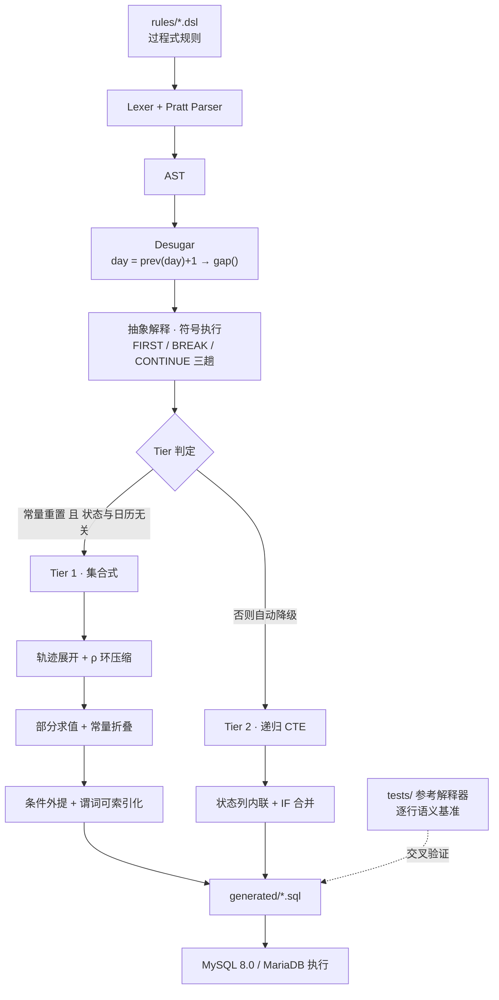
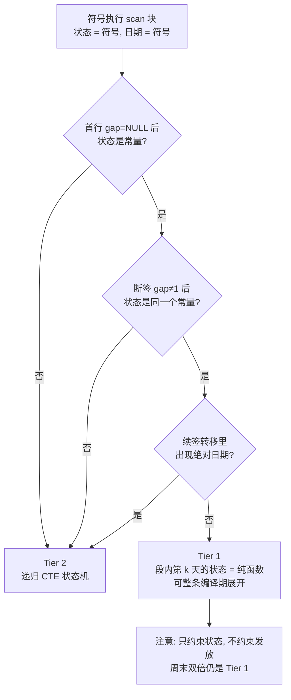
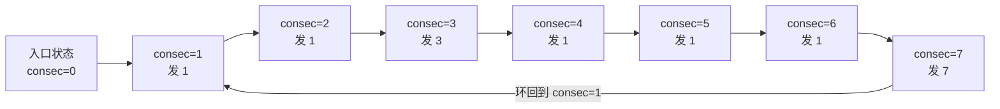
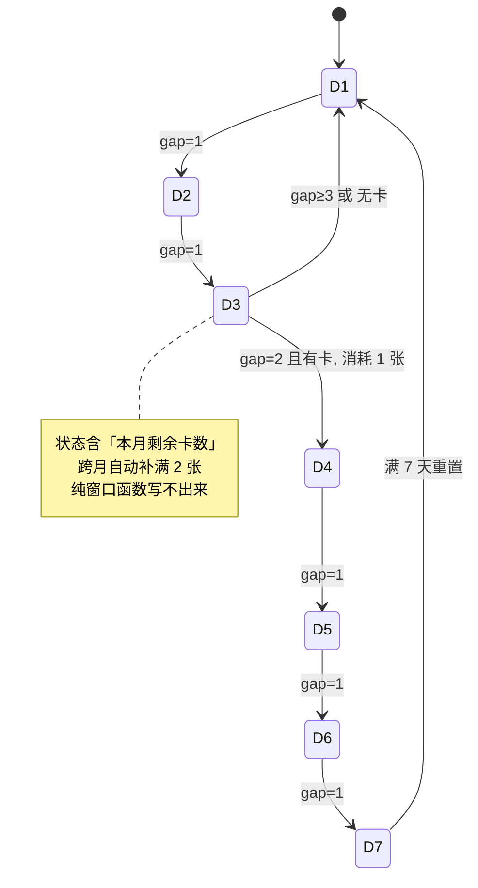

# signin-coins

**签到规则 DSL → 通用编译器 → 高效 SQL。**
人写过程式规则（和 MySQL `@用户变量` 一样直观），机器产集合式 SQL（窗口函数 + 编译期常量表），
只有真正需要运行时状态的规则才退化为递归 CTE。

- 单文件编译器 `dslc.py`，**零第三方依赖**，Python 3.10+
- 产物只用 MySQL 8.0 / MariaDB 10.2+ 的公开语法，**不依赖已弃用的 `@x := ` 写法**
- 35 个无数据库单元测试 + 8 条规则 × 2 条后端的端到端交叉验证，全部通过

> 缘起：一道"连续签到发金币"的 SQL 题。手写 `@用户变量` 很直观但语义未定义；
> 手写窗口函数很快但规则一改就得重写。这个仓库的答案是：**别让人在这两者之间做选择，让编译器选。**

---

## 1. 三十秒看懂

<table>
<tr><th>人写的（DSL）</th><th>机器产的（SQL）</th></tr>
<tr valign="top"><td>

```
state { consec := 0 }

scan {
  if day = prev(day) + 1
     and consec < 7 {
    consec := consec + 1
  } else {
    consec := 1
  }

  coin := 1
  if consec = 3 { coin := coin + 2 }
  if consec = 7 { coin := coin + 6 }
  emit coin as coin
}
```

</td><td>

```sql
-- 编译器展开的状态轨迹：8 行（前缀 1 + 周期 7）
sched AS (
    SELECT 1 AS k, 1 AS coin
    UNION ALL SELECT 2, 1
    UNION ALL SELECT 3, 3
    UNION ALL SELECT 4, 1
    UNION ALL SELECT 5, 1
    UNION ALL SELECT 6, 1
    UNION ALL SELECT 7, 7
    UNION ALL SELECT 8, 1
),
daily AS (
    SELECT n.uid, n.dt, s.coin
    FROM n JOIN sched s
      ON s.k = IF(n.k < 2, n.k,
                  2 + MOD(n.k - 2, 7))
)
```

</td></tr>
</table>

右边那 8 行**不是手写的**，是编译器把左边的过程式规则跑出来、做环检测压缩、再常量折叠得到的。
产物里一个 `IF` 都没有。完整 SQL 见 [`generated/r1_original.sql`](generated/r1_original.sql)。

**所以"金币改成斐波那契数列"不是问题**：DSL 里换成三个变量顺序倒腾，编译器自动产出
`(1,1),(2,1),(3,2),(4,3),(5,5),(6,8),(7,13),(8,1)`。
不重置就展开成 31 行；封顶就识别出"前缀 18 + 不动点"。`MOD(...,7)` 只是周期恰好为 7 的特例。

---

## 2. 编译管线



### Tier 判定：编译器怎么证明"可以不用逐行递归"



判定不通过时 `--explain` 会打印原因；`--tier 1` 强行绕过会**直接报错**，不会给你一份算错的 SQL。

### 状态轨迹的 ρ 形压缩（原题）



前缀 1 行 + 周期 7 行 = **8 行日程表**，索引式 `IF(k < 2, k, 2 + MOD(k - 2, 7))` 由编译器生成。
"满 7 天重置"从此不是代码里的 `IF`，而是**轨迹的形状**。

### 真需要运行时状态的规则（Tier 2 示例：每月 2 张补签卡）



DSL 写法和原题一样直观，通用性由后端兜底 —— 见 [`rules/r7_makeup_card.dsl`](rules/r7_makeup_card.dsl)。
这条规则的**完整自然语言活动规则**（额度重置时点、可补条件、跨月顺序、
"补签日是否计入连续天数"的歧义裁定、逐日算例）见 **[docs/RULES.md §1](docs/RULES.md)**。

---

## 3. 快速开始

```bash
# 只要 Python 3.10+，无需装任何包
python3 dslc.py rules/r1_original.dsl                 # 打印 SQL
python3 dslc.py rules/r2_fib_cycle7.dsl --explain      # 编译决策 + SQL
python3 dslc.py rules/r7_makeup_card.dsl --out q.sql   # 写文件
python3 dslc.py rules/r1_original.dsl --json           # 接流水线

make test        # 35 个单元测试，不需要数据库
make sql         # 重新生成 generated/*.sql
make sql-check   # 产物漂移检测（CI 用）
make e2e         # 端到端 + 基准（需要 MySQL/MariaDB）
make e2e-fast    # 只跑端到端正确性
make mermaid     # 校验文档里的 Mermaid 图（需要 node）
```

端到端测试的数据库连接用环境变量配置，脚本会自动建库：

```bash
# 方式一：本机 socket
export MYSQL_SOCKET=/tmp/mysql.sock MYSQL_USER=root
# 方式二：TCP（docker compose up -d 之后）
export MYSQL_HOST=127.0.0.1 MYSQL_PORT=3306 MYSQL_USER=root MYSQL_PASSWORD=secret
make e2e
```

`docker-compose.yml` 提供了 MySQL 8.0 与 MariaDB 10.11 两个实例，方便对照方言差异。

---

## 4. 实测结论

环境：MariaDB 10.11 / 单机 / 含客户端开销。完整原始输出见 [`docs/verify-log.txt`](docs/verify-log.txt)。

**正确性**：8 条规则 × 2 条后端，全部与独立逐行解释器一致。

| 规则 | 选路 | 日程表 | 周期 | 常量折叠 |
|---|---|---|---|---|
| r1 原题 | Tier 1 | 8 行 | 7 | ✅ |
| r2 斐波那契 + 满 7 重置 | Tier 1 | 8 行 | 7 | ✅ |
| r3 斐波那契不重置 + 封顶 | Tier 1 | 19 行 | 1（不动点） | ✅ |
| r4 纯斐波那契不重置 | Tier 1 | 31 行 | 无环 | ✅ |
| r5 原题 + 周末双倍 | Tier 1 | 8 行 | 7 | ❌ → 条件外提 |
| r6 断签保留一半进度 | Tier 2 | — | — | — |
| r7 每月 2 张补签卡 | Tier 2 | — | — | — |
| r8 改成 9 天一轮 | Tier 1 | 10 行 | 9 | ✅ |

**性能**（同数据、同规则、三条路径）：

| 规模 | Tier 1 | Tier 2 | `@变量`原版 |
|---|---|---|---|
| 200 用户 / 2.4 万行 | **45 ms** | 75 ms | 94 ms |
| 1000 用户 / 11.8 万行 | **205 ms** | 386 ms | 419 ms |
| 4000 用户 / 47.1 万行 | **941 ms** | 1735 ms | 1725 ms |

只有 ~1.8x，不是一个数量级 —— 三条路径主要成本都是扫日志 + 去重 + 排序。
Tier 1 的真正价值是**复杂度形状**：可并行、可走索引、可物化成 `daily` 事实表增量刷新。

**和原始 `@用户变量` 解法对账**（[`tests/fixtures/original_uservars.sql`](tests/fixtures/original_uservars.sql)）：

- 干净数据上**结果完全一致** —— 原思路是对的，这点没被否定。
- 同一天有多条 `sign_in=1` 日志时：**错 133/150 组**（重复行让连续天数相位整体错位）。
- **"语义未定义"是可复现的，不是理论警告**：

  ```
  插入顺序实验（行集合完全相同，只改物理插入顺序）
    原始顺序      原版: 错 133/150 组
    打乱 seed=42  原版: 直接报错 ERROR 1690 BIGINT UNSIGNED value is out of range
    打乱 seed=99  原版: 直接报错 ERROR 1690 BIGINT UNSIGNED value is out of range
    三种情况下 DSL 产物指纹恒为 bc9dfd41ef，且与参考一致

  优化器开关实验（数据与 SQL 一字不改）
    derived_merge=on  → 指纹 496adc8f3e，错 133/150
    derived_merge=off → 指纹 90c975ac2f，错 132/150
  ```

  （开关实验的具体指纹随执行计划变化，插入顺序实验则稳定复现。）
  同一份数据、同一条查询，换个插入顺序就**报错**，换个优化器开关就**换答案**。
  根因：派生表 `ORDER BY` 是否生效、以及同一 SELECT 内用户变量的赋值/读取顺序，MySQL 都不保证。
  DSL 把顺序变成语言语义，产物用 `ROW_NUMBER()` 显式定序，因此与执行计划无关。

---

## 5. 仓库结构

```
signin-coins/
├── dslc.py                     # 单文件编译器 + CLI + 参考解释器
├── rules/                      # 8 条示例规则（DSL）
├── generated/                  # 编译产物 SQL，提交进仓库便于 review 与漂移检测
├── tests/
│   ├── test_compiler.py        # 35 个单元测试，无需数据库
│   ├── e2e_verify.py           # 端到端交叉验证 + 基准，需要数据库
│   └── fixtures/               # 原始 @用户变量 解法（对账用）
├── docs/
│   ├── RULES.md                # 活动规则自然语言口径（含补签卡完整规格与逐日算例）
│   ├── DESIGN.md               # 设计文档：判定定理、四个优化、边界与不保证
│   ├── DSL.md                  # 语言参考：语法、语义、函数表
│   ├── BENCHMARKS.md           # 性能数据与复现方法
│   └── verify-log.txt          # 最近一次实测完整输出
├── tools/check_mermaid.mjs     # 用真正的 mermaid 解析器校验文档里的图
├── docker-compose.yml          # MySQL 8.0 + MariaDB 10.11 测试实例
├── pyproject.toml              # 可选安装：pip install -e . → dslc 命令
├── Makefile                    # test / sql / sql-check / e2e / bench / mermaid / clean
└── .github/workflows/ci.yml    # 单元测试矩阵 + Mermaid 校验 + MySQL8/MariaDB 端到端
```

延伸阅读：**[活动规则口径](docs/RULES.md)** · **[语言参考](docs/DSL.md)** · **[设计文档](docs/DESIGN.md)** · **[性能与复现](docs/BENCHMARKS.md)**

---

## 6. 已知边界

1. Tier 2 需放开递归深度：MySQL `cte_max_recursion_depth`（默认 1000 会直接报错）、MariaDB `max_recursive_iterations`。产物头部已带提示。
2. 顺序赋值靠**表达式内联**消解，深层嵌套时体积可能指数增长；`info.sql_chars` 是告警指标。递归 CTE 的递归段不能引用自身做子查询，所以没法用派生表做 let 绑定 —— 这是 MySQL 的硬限制。
3. 符号判定**保守**：可能把某些其实可优化的规则判成 Tier 2（宁可慢不可错），反之不会。
4. `scan` 里还不能 join 维表（"按用户等级给倍率"）。当前应放到 `report` 层；要支持需加 `lookup` 语法并把维表列纳入判据。
5. 日期类型推断是语法级的：`day + 1` 认得出来，状态变量里存日期再做加减请显式用 `date_add/date_sub`。
6. 不封顶的斐波那契增长极快，注意 BIGINT / DECIMAL 溢出（r4 故意只用 30 天窗口）。
7. `report` 块是原生 MySQL 方言，未做跨方言转译。
8. 本地实测在 **MariaDB 10.11** 上完成；CI 里配了 MySQL 8.0 的端到端 job，
   但该 job 未在作者环境实际跑过，首次接入请以 CI 结果为准。

---

## 7. 一个更重要的工程判断

这套编译器解决的是"**用声明式引擎正确地重算过程式规则**"：面试题、历史回溯、风控审计、活动复盘、
以及"规则天天变但不想天天改 SQL"的运营报表。

但**线上发币不该靠查询反推**。正确的架构是签到时应用层写一条
`coin_ledger(uid, dt, rule_version, coin, reason)` 流水，统计层永远只是 `SUM(...) GROUP BY`。
这样规则改版天然带版本号，历史不会被新规则重算污染 ——
"规则一变 SQL 就不知道怎么改"的根子在**把业务策略塞进了查询**，而不在 SQL 技巧。

若要在报表侧继续保留策略，就把产物里的 `sched` **物化成带生效时间的规则表**
（`rule_version, valid_from, valid_to, k, coin`），`daily` 侧按 `dt` join 对应版本：
这时规则变更连编译都不用，改数据即可；Tier 2 那类真状态机规则仍由编译器兜底。

---

## License

MIT，见 [LICENSE](LICENSE)。
