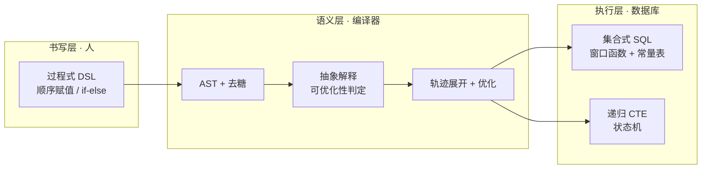
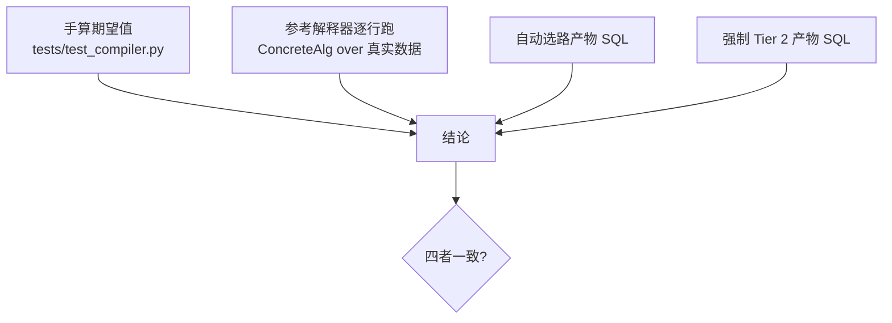

# 设计文档

> 面向想改编译器的人。语言用法见 [DSL.md](DSL.md)，性能数据见 [BENCHMARKS.md](BENCHMARKS.md)。

## 1. 问题陈述

一道"连续签到发金币"的 SQL 题，有两种常见解法，各有致命缺陷：

| 解法 | 优点 | 缺陷 |
|---|---|---|
| `@用户变量` 过程式扫描 | 直观、通用，规则怎么变都能写 | 求值顺序**未定义**；8.0.13 起弃用；逐行串行 |
| 手写窗口函数（islands + `MOD`） | 快、可并行 | 规则一改就得重推数学；非周期规则直接写不出来 |

关键观察：**过程式解法的通用性来自它是一个状态机；它的慢与危险来自状态机被放在了数据侧。**
而绝大多数签到规则的状态空间小到**可以在编译期整个展开**。一旦展开，"过程"就消失了。

于是分三层，各取所长：



**人不必在"直观"和"快"之间做选择，让编译器选。**

---

## 2. 中间表示与三种值代数

AST 节点：`Lit / Ident / Prev / Call / Bin / Un / Sym`，
语句：`Assign / If / Emit`。整个 `scan` 块就是一段直线 + 分支的赋值程序。

**同一个语句执行器**（`Interp.run`）配三种"值代数"，这是整个编译器的骨架：

| 代数 | 值是什么 | 分支怎么处理 | 用途 |
|---|---|---|---|
| `ConcreteAlg` | Python 值（含 SQL NULL 语义） | 条件已知，只走一支 | 参考解释器、展开轨迹 |
| `SymbolicAlg` | Python 值 **或** AST（含 `Sym`） | 条件未知则两支都走，合并成 `if(c,a,b)` 树 | 可优化性判定、部分求值 |
| `SqlAlg` | `Sql(文本, 是否DATE, 编译期常量)` | 永远两支都走，合并成 `IF(c,a,b)`；条件常量已知则折叠 | 代码生成 |

好处是**语义只实现一次**：判定、展开、生成共享同一套语句语义，不会漂移。
`Interp.merge_env` 负责分支合并：对每个变量取 `merge(cond, then值, else值)`，
两支相同则直接塌缩 —— 这是产物不至于爆炸的第一道防线。

`SqlAlg` 的 `Sql.c` 字段携带"编译期已知常量"，使得递归 CTE 的基准行能被折叠成
`CAST(1 AS SIGNED)` 而不是 `CAST(IF((NULL = 1) AND (0 < 7), ...) AS SIGNED)`。

---

## 3. 判定定理

设状态向量 $s$，一天的输入为 $(\text{day}, \text{gap})$，`scan` 块定义转移
$s' = F(s, \text{day}, \text{gap})$，发放 $c = G(s, \text{day}, \text{gap})$。

> **Tier 1 充分条件**
> 1. $F(s, \cdot, \text{NULL}) = F(s, \cdot, g) = R$ 对任意 $s$ 与任意 $g \neq 1$ 成立（**常量重置**）
> 2. $F(s, \text{day}, 1)$ 与 $\text{day}$ 无关（**状态转移与日历无关**）
>
> 则一段连续签到内第 $k$ 天的入口状态
> $e_1 = I,\; e_2 = R,\; e_{k} = F(e_{k-1}, \cdot, 1)$
> 只依赖 $k$，与用户、日期、段外历史无关 → 可编译期整条展开。

注意 **②只约束状态，不约束发放**：$G$ 可以随便依赖 `day`（周末双倍、月末加码），
因为发放表达式最终在 SQL 里对着真实日期求值。

### 怎么判定

符号执行三趟，状态变量绑成 `Sym("st_x")`、日期绑成 `Sym("day")`：

| 模式 | `gap()` 绑定 | 检查 |
|---|---|---|
| FIRST | `NULL` | 结果状态是否全为具体常量 |
| BREAK | `Sym("gap", ne1=True)`（已知 ≠1，具体值未知） | 同上，且与 FIRST 的结果相等 |
| CONTINUE | `1` | 结果状态表达式是否含 `Sym("day")` / `Sym("prev_day")` |

三值化简是判定精度的关键：`NULL AND x` 永不为真、`False AND x = False`、
`True AND x = x`。少了这条，`gap()=1 and consec<7` 在 FIRST 模式下会无谓分叉，
把本来能优化的规则误判成 Tier 2。

**保守性**：合并后只要状态还含符号就降级。可能漏判（宁可慢不可错），不会误判。
`--tier 1` 强制绕过会抛 `DslError`。

### 一个真实的坑

第一版 ρ 环检测把首行也纳入环的候选，导致斐波那契规则被判成"周期 1"。
原因：**首行走的是 $F(\cdot,\cdot,\text{NULL})$，第 2 天起走 $F(\cdot,\cdot,1)$，是两个不同函数**。
当 $I = R$ 时（斐波那契正是如此：初值 `f_prev=0,f_cur=1`，重置后也一样），
朴素环检测会误认为轨迹恒定。修法：环检测从 $k=2$ 开始，首行永远是纯前缀。
`tests/test_compiler.py::TestUnroll::test_r4_uncapped_fib_has_no_cycle` 锁死了这个回归。

---

## 4. 四个优化

### 4.1 ρ 环压缩

展开时用哈希表记录 `(状态元组 → k)`，首次重复即得到前缀 $p$ 与周期 $T$：

```
索引式 = IF(k < p, k, p + MOD(k - p, T))     # p = 1 时退化为 MOD(k-1,T)+1
```

| 规则 | 轨迹形状 | 日程表 |
|---|---|---|
| 原题 | 前缀 1 + 周期 7 | 8 行 |
| 斐波那契 + 满 7 重置 | 前缀 1 + 周期 7 | 8 行 |
| 斐波那契不重置 + 封顶 1000 | 前缀 18 + 不动点 | 19 行 |
| 纯斐波那契不重置 | 无环 | 按窗口上界展开（31 行） |

无环时展开上界 = 窗口天数 + 1，即窗口内最长可能连续天数；上界不足**直接报错**而非静默截断。

### 4.2 部分求值 + 常量折叠

日程表既然是编译期展开的，就对每一行用 `SymbolicAlg` 再跑一遍 `scan`：
状态是具体值、日期是符号。若发放结果不含符号 → 它就是个常量，直接存进日程表。

于是原题产物里**一个 `IF` 都没有**，`daily` 退化成一次小表 join。

安全护栏：若首行落在环里（$p=1$），`k=1` 与 `k=1+T` 的 `gap` 不同，
不能共用一个折叠常量 → 退回模式 B。

### 4.3 条件外提（unswitching）

发放依赖日期时（模式 B），各天往往共享同一个日期条件。
把条件提到分派外面，而不是在每一项里重复：

```sql
-- 之前：ELT(idx, IF(周末,2,1), IF(周末,2,1), IF(周末,6,3), ...)
-- 之后：
IF(DAYOFWEEK(n.dt) = 1 OR DAYOFWEEK(n.dt) = 7,
   ELT(idx, 2, 2, 6, 2, 2, 2, 14, 2),
   ELT(idx, 1, 1, 3, 1, 1, 1,  7, 1))
```

模式 B 下状态已被全部折叠，`sched` CTE 整个消失，只剩 `n` 上的一个表达式。

### 4.4 谓词可索引化

`day = date(col)` 时把 `date(col) BETWEEN ...` 改写成 `col >= 'start 00:00:00' AND col < 'end+1'`，
让 `(entity, col)` 索引可用。`info.sargable_pushdown` 报告是否触发。

---

## 5. Tier 2 代码生成

```sql
WITH RECURSIVE d AS (...), seq AS (... ROW_NUMBER() ...),
walk AS (
    SELECT s.uid, s.dt, s.i, <post 状态>, <emit>   -- 基准行：i=1，入口=初值，gap=NULL
    FROM seq s WHERE s.i = 1
    UNION ALL
    SELECT s.uid, s.dt, s.i, <post 状态>, <emit>   -- 递归行：入口=w.st_*，gap=DATEDIFF(s.dt,w.dt)
    FROM walk w JOIN seq s ON s.uid = w.uid AND s.i = w.i + 1
)
```

三个必须注意的点：

1. **`walk` 携带的是 post 状态，`emit` 读的是 entry 状态** —— 因为 `emit` 可能出现在赋值之前。
   代码生成时用 `entry = w.st_*` 建环境，跑完整个 body 得到 post 与 emit，顺序天然正确。
2. **顺序赋值只能内联**：MySQL 禁止递归段里用引用自身的子查询，所以没法用派生表做 let 绑定。
   代价是表达式体积可能指数增长，`info.sql_chars` 是这个风险的观测指标。
3. **基准行决定列类型**：MySQL 递归 CTE 用基准行推断类型，`NULL` 或短字符串会导致截断。
   编译器先用 `ConcreteAlg` 跑一遍首行拿到样本类型，再给基准行加
   `CAST(... AS SIGNED / DECIMAL(24,6) / CHAR(255) / DATE)`。

递归深度：MySQL `cte_max_recursion_depth` 默认 1000，**按产出行数计**而非按组计，
几千人日就会超。产物头部带 `SET SESSION` 提示，`tests/e2e_verify.py` 会按服务端方言自动下发。

---

## 6. 验证方法论

三重独立性，避免"拿编译器验编译器"：



1. **手算期望**：单元测试里 10 天连签、断签保留一半、补签卡跨月等场景的期望值是人工算的常量，
   口径来源是 [RULES.md](RULES.md)，规格 ↔ 实现 ↔ 测试三者一一对应。
2. **参考解释器**：`reference_daily` 按 DSL 语义逐行跑真实数据，落成 `ref_*` 表，
   再套用**同一段 report SQL**，排除聚合层差异。
3. **双后端交叉**：同一条规则同时跑自动选路与强制 Tier 2，两条完全不同的 SQL 必须给出相同结果。
4. **产物漂移检测**：单元测试比对 `generated/*.sql` 与实时编译结果，防止仓库里的产物过期。

数据生成覆盖：全勤 / 偶尔断签 / 稀疏 / 整月不签 / 规律 7 连 2 断 / 隔天签 /
同日重复日志 / `artical_id<>0` 但 `sign_in=1` 的脏数据 / 活动期外的行。

### 顺手证明了原解法的语义未定义

不是引用文档，而是可复现实验（见 `docs/verify-log.txt`）：

- 行集合完全相同，只改**物理插入顺序** → 原 `@变量` 解法从"错 133/150 组"变成
  **直接报错** `ERROR 1690 BIGINT UNSIGNED value is out of range`
  （`cast(coin as unsigned)` 的累计余额不再单调，月末差分下溢）。
- 数据与 SQL 一字不改，只切 `derived_merge` 开关 → 结果指纹变化。
- 同条件下编译产物指纹恒定。

---

## 7. 边界与不保证

1. Tier 2 需要放开递归深度（见上）。
2. 内联可能指数膨胀；`sql_chars` 告警。
3. 符号判定保守，可能漏判可优化规则。
4. `scan` 不能 join 维表；`report` 层可以。
5. 日期类型推断是语法级的，状态变量存日期请显式用 `date_add/date_sub`。
6. 数值溢出由使用者负责（不封顶的斐波那契增长极快）。
7. `report` 是原生 MySQL 方言，未做跨方言转译。
8. 本地实测在 MariaDB 10.11 完成；CI 里配了 MySQL 8.0 的端到端 job，
   但**该 job 未在作者环境实际跑过**，首次接入请以 CI 结果为准。

---

## 8. 扩展路线

| 方向 | 做法 | 影响面 |
|---|---|---|
| 维表倍率（按等级/城市） | 加 `lookup(tbl, key) -> col` 语法；把维表列视为"日期无关但行相关"的输入，纳入判定 | 中 |
| 规则版本化 | 把 `sched` 物化成 `(rule_version, valid_from, valid_to, k, coin)`，`daily` 按 `dt` join 版本 | 小，且规则变更无需重编译 |
| 跨方言 | `report` 层接 sqlglot 之类转译器；`FUNCS_SQL` 按方言分支 | 中 |
| 旧 SQL 自动迁移 | 写一个 `@变量` SELECT 的 lifter：`vars` 派生表 → `state`，`IF(c,@x:=a,@x:=b)` → `if/else`，`CASE` → 嵌套 `if`，`ORDER BY` → `entity/day` | 大，但 IR 已经就位，只是再加一个前端 |
| let 绑定消膨胀 | 非递归段用派生表分层；递归段只能靠公共子表达式提取 + 状态列 | 中 |
| 增量物化 | `daily` 落事实表，按 `dt` 增量刷新；跨段边界需要回看一天 | 中 |

**最后一条工程判断**：线上发币应写 `coin_ledger` 流水，统计只做 `SUM`。
本编译器的定位是"用声明式引擎正确地重算过程式规则"——面试题、历史回溯、风控审计、运营报表。
